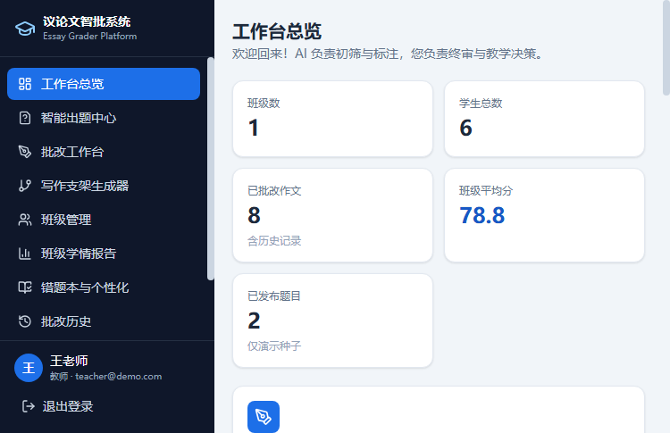

# 议论文智能批改与教学辅助系统（P0 MVP）

面向中学语文教师的 Web 应用：**AI 负责初筛和标注，教师负责终审与教学决策**。
本仓库为可本地运行的最小可用版本（P0），并已覆盖大部分 P1 能力。

> 演示说明：本机无 PostgreSQL / DeepSeek Key 时，默认使用 **JSON 文件存储** +
> **内置演示 AI（mock）**，开箱即用；配置 `DEEPSEEK_API_KEY` 后自动切换真实
> DeepSeek 模型。生产环境默认不在失败后偷偷回退演示结果，以免把低质量模板误当成真实 AI；如确需演示回退，可设置 `AI_FALLBACK_TO_MOCK=true`。

---

## 已实现功能

| 模块 | 说明 |
| --- | --- |
| 登录 / 注册 | 邮箱 + 密码，JWT 鉴权，teacher / admin 两种角色 |
| 智能出题中心 | 省份/年级/话题关键词/思辨类型 → 材料作文题 + 评分细则 + 偏题陷阱；保存草稿 / 发布 / 一键复制 |
| 批改工作台（核心） | 支持文字、语音与**整张答题卡图片**；自动裁切作文三栏并调用手写 OCR；AI 按四个固定区间先判档再定分，教师可编辑后**保存入库** |
| 人工样本校准 | 内置本次提供的 74 篇教师核定作文；仅在匹配“突围与成长”题目时启用，避免跨题误用；高度相似原文优先采用教师核定分 |
| 写作框架辅助 | 立意三梯度 + 论证大纲（并列/递进）+ 素材推荐表（知识库/联网） |
| 班级管理（含子功能） | 班级与学生（创建/导入/学生列表）、班级学情报告、错题本与个性化 |
| 批改历史与检索 | 按班级/学生/题目/错误标签/时间筛选；导出 CSV（Excel 可打开） |
| 班级学情报告（班级管理子功能） | 共性薄弱 TOP3 + 进步曲线 + 优秀片段墙（一键置顶）+ **一键讲评课大纲** |
| 错题本与个性化（班级管理子功能） | 学生逻辑错误标签汇总；AI 生成专属学习建议并一键布置任务 |

| 白名单素材库 | 教研组录入/核验，AI 仅引用知识库（严禁爬虫） |

## 技术栈

- 前端：React 18 + TypeScript + Vite + Tailwind CSS（shadcn 风格自研组件）+ recharts
- 后端：Node.js 24（原生运行 TS）+ Express + TypeScript
- 存储：本地演示用 JSON 文件（`server/data/db.json`）；生产切 PostgreSQL，`db/schema.sql` 为完整 ERD
- AI：可插拔适配器（`server/src/ai`）—— DeepSeek API / 内置演示模式
- 认证：JWT（teacher / admin）
- 语音输入：Web Speech API（浏览器原生，推荐 Chrome / Edge）
- 部署：`docker-compose.yml` 一键启动

## 快速开始（无需任何配置）

要求：Node.js ≥ 22.6（推荐 24）。

```bash
# 1. 安装依赖（server / client 各一次）
pnpm --dir server install
pnpm --dir client install

# 2. 构建前端（vite build → client/dist，由后端托管）
pnpm --dir client build

# 3. 启动（默认 4000 端口，根目录运行以避免沙箱/路径问题）
node server/src/index.ts
```

打开浏览器访问 **http://localhost:4000**

演示账号：

| 角色 | 邮箱 | 密码 |
| --- | --- | --- |
| 教师 | teacher@demo.com | 123456 |
| 管理员 | admin@demo.com | 123456 |

> 如果 `pnpm` 不可用，可改用 npm：`cd server && npm install && cd ../client && npm install && npm run build && cd .. && node server/src/index.ts`。

### 开发模式（前后端热更新）

```bash
pnpm --dir server install
pnpm --dir client install
node scripts/dev.mjs
# API: http://localhost:4000   前端(Vite): http://localhost:5173（/api 已代理到 4000）
```

## 接入真实 AI（DeepSeek）

```bash
# Windows PowerShell
$env:DEEPSEEK_API_KEY="sk-xxxx"
$env:AI_MODE="auto"        # auto|mock|deepseek；留空 auto：有 Key 用 DeepSeek，无 Key 用演示
$env:ENABLE_WEB_SEARCH="true"   # 出题/素材时启用联网检索（按模型能力）
node server/src/index.ts
```

`server/src/ai/` 目录：`index.ts`（提供方选择）→ `deepseek.ts`（真实 API，JSON 输出）
/ `mock.ts`（演示模式，含启发式骨架/逻辑/论据/评分分析）。

## 整张答题卡识别

Render 环境变量需设置 `OCR_PROVIDER=tencent`、`TENCENT_SECRET_ID`、`TENCENT_SECRET_KEY` 和 `TENCENT_REGION=ap-guangzhou`。前端会先排除题干、姓名、条码与红色教师标记，再按左、中、右三栏提交腾讯云手写体 OCR。识别结果进入可编辑文本框，批改前应人工快速校对。

完整部署步骤见 [DEPLOYMENT.md](./DEPLOYMENT.md)。

## 重置演示数据

停止服务后删除 `server/data/db.json` 并重启即可重新灌入种子数据（班级/学生/题目/历史批改等）。

## 切换 PostgreSQL

1. `docker compose up -d db`（或自行启动 Postgres + pgvector）
2. 将 `db/schema.sql` 导入数据库
3. 用 Prisma / pg 驱动重写 `server/src/db/store.ts` 的实现（对外接口为按“表”的 find/insert/update/remove，替换成本低）
4. 如需语义查重，可为 `corrections` 增加 embedding 列并用 pgvector 做相似度检索（`db/schema.sql` 中已留注释）

## Docker 一键启动

```bash
docker compose up --build
# http://localhost:4000
```

> compose 会同时启动 postgres(pgvector) 与 app 容器；app 当前 MVP 默认使用挂载卷中的 JSON 数据文件，Postgres 作为下一步迁移目标已就绪。

## 目录结构

```text
server/            Express + TS API（auth/questions/corrections/scaffold/classes/reports/students/materials/plagiarism）
  src/ai/          AI 适配器（deepseek / mock，可插拔；生产默认不自动回退）
  src/db/          JSON 存储层 + 种子数据
client/            React 18 + TS + Tailwind 前端（pages/components/lib）
db/schema.sql      PostgreSQL 完整 ERD（与需求文档一致）
docs/screenshots/  界面截图
scripts/dev.mjs    一键开发模式
```

## 截图





